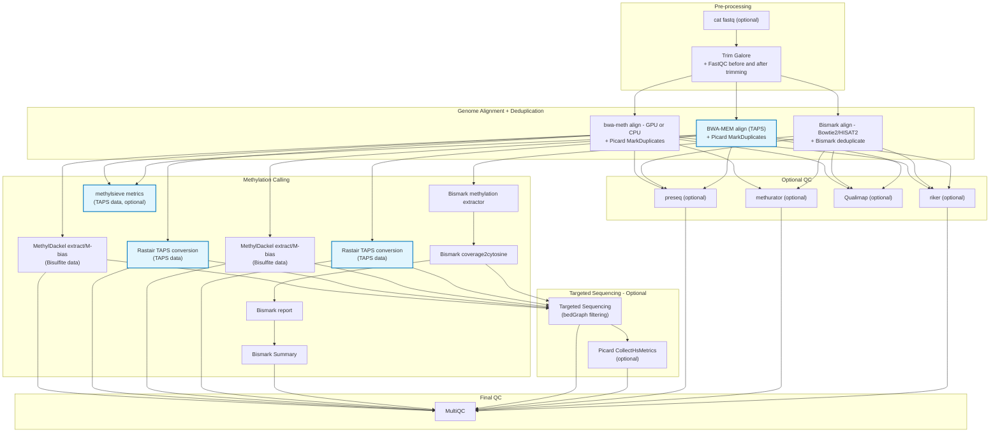

# nf-core/methylseq: Usage

## :warning: Please read this documentation on the nf-core website: [https://nf-co.re/methylseq/usage](https://nf-co.re/methylseq/usage)

> _Documentation of pipeline parameters is generated automatically from the pipeline schema and can no longer be found in markdown files._

## Table of contents

- [Introduction](#introduction)
- [Requirements](#requirements)
- [Workflow: Bismark](#workflow-bismark)
- [Workflow: BWA-Meth](#workflow-bwa-meth)
- [Workflow: BWA-MEM + TAPS](#workflow-bwa-mem-taps-tet-assisted-pyridine-borane-sequencing)
- [Illumina 5-Base and TAPS: rastair or Bismark](#illumina-5-base-and-taps-rastair-or-bismark)
- [UMIs (optional)](#umis-optional)
- [Targeted sequencing (optional)](#targeted-sequencing-optional)
- [Methylation summary and spike-in controls (optional)](#methylation-summary-and-spike-in-controls-optional)
- [Samplesheet input](#samplesheet-input)
- [Running the pipeline](#running-the-pipeline)
- [Updating the pipeline](#updating-the-pipeline)
- [Reproducibility](#reproducibility)

## Introduction

The nf-core/methylseq pipeline provides three distinct workflows for DNA methylation analysis. These workflows support different aligners and cater to a range of computational requirements.

> Read more about **Bisulfite Sequencing & Three-Base Aligners** used in this pipeline [here](usage/bs-seq-primer.md)

### Requirements

- Nextflow >= 24.10.5
- Container runtime: Docker, Singularity, Podman, Charliecloud, or Apptainer. Conda is also supported for CPU workflows, but the Parabricks GPU pathway does not support Conda/Mamba.



### Workflow: Bismark

By default, the nf-core/methylseq pipeline uses [Bismark](http://www.bioinformatics.babraham.ac.uk/projects/bismark/) with [Bowtie2](http://bowtie-bio.sourceforge.net/bowtie2/index.shtml) as the alignment tool. This configuration is optimized for most DNA methylation workflows and will run unless an alternative aligner is specified.

Starting with Bismark `v0.21.0`, the pipeline also supports [HISAT2](https://ccb.jhu.edu/software/hisat2/index.shtml) as an alternative aligner. To activate this option, use the command-line flag `--aligner bismark_hisat`.

> HISAT2 offers splice-aware alignment, making it suitable for RNA-based analyses. For such cases, you can supply a file with known splice sites using the `--known_splices` parameter.

#### Combined-index alignment (`--combined_index`)

By default Bismark aligns each read against separate C→T- and G→A-converted genome indices (the classic per-strand model, parallelised with `--multicore`). Bismark `v3.1.0`+ can instead align against a single **combined** CT+GA index with `--combined_index`, which is generally faster and lighter — it loads the index once and is parallelised with Bowtie 2/HISAT2 threads (`-p`) rather than the fork-based `--multicore`. Directional and PBAT libraries use `--combined_index`; non-directional libraries additionally use `--combined_index_sequential` (the leanest execution model). It applies to the `bismark` and `bismark_hisat` aligners.

Combined-index results are **concordance-gated, not byte-identical** to the classic per-strand model (roughly 1 read in 10⁴ is placed differently but equally validly). The option is **off by default**, so default runs are unchanged.

> **`--combined_index` requires a genome index built with `--combined_genome`.** When the pipeline builds the index itself (i.e. you do not pass `--bismark_index`), it does this automatically. **Pre-built indexes are not compatible** — including AWS iGenomes (`--genome`) and any `--bismark_index` that lacks a `Bisulfite_Genome/Combined/` directory. Such runs fail with a clear message; rebuild your own genome, or omit `--combined_index`. The option is ignored when `--local_alignment` is set (combined-index alignment does not support soft-clipping).

### Workflow: BWA-Meth

The second workflow uses [BWA-Meth](https://github.com/brentp/bwa-meth) as the alignment tool and [MethylDackel](https://github.com/dpryan79/methyldackel) for post-processing.

bwa-meth aligner options:

- Standard `bwa-meth` (CPU-based): This option can be invoked via `--aligner bwameth` and uses the traditional BWA-Meth aligner and runs on CPU processors. By default, this uses the standard BWA-MEM algorithm.

- BWA-MEM2 algorithm: For improved performance, you can enable the BWA-MEM2 algorithm by adding `--use_mem2` to your command. BWA-MEM2 is a drop-in replacement for BWA-MEM that is generally faster and more accurate. This applies to both CPU and GPU modes.

Examples:

```bash
# Use BWA-Meth with BWA-MEM2 algorithm (CPU)
nextflow run nf-core/methylseq --aligner bwameth --use_mem2 --input samplesheet.csv --genome GRCh38

# Use BWA-Meth with BWA-MEM2 algorithm (GPU)
nextflow run nf-core/methylseq --aligner bwameth --use_mem2 --profile gpu --input samplesheet.csv --genome GRCh38
```

- `Parabricks/FQ2BAMMETH` (GPU-based): For higher performance, the pipeline can leverage the [Parabricks implementation of bwa-meth (fq2bammeth)](https://docs.nvidia.com/clara/parabricks/latest/documentation/tooldocs/man_fq2bam_meth.html), which implements the baseline tool `bwa-meth` in a performant method using fq2bam (BWA-MEM + GATK) as a backend for processing on GPU. To use this option, include the `gpu` profile (as in `--profile gpu`) along with `--aligner bwameth`.

### Workflow: BWA-MEM + TAPS (TET-Assisted Pyridine borane Sequencing)

The pipeline supports **TAPS data analysis**, which uses a different approach to detect DNA methylation compared to traditional bisulfite sequencing. TAPS preserves the original DNA sequence while converting methylated cytosines to thymine, making it compatible with standard aligners.

#### TAPS vs Bisulfite Sequencing

| Feature                   | Bisulfite Sequencing              | TAPS                              |
| ------------------------- | --------------------------------- | --------------------------------- |
| **DNA Conversion**        | C→T (unmethylated cytosines)      | 5mC→T (methylated cytosines)      |
| **DNA Degradation**       | High (harsh chemical treatment)   | Minimal (enzymatic treatment)     |
| **Sequence Complexity**   | Reduced (C→T conversion)          | Preserved (original sequence)     |
| **Aligner Compatibility** | Requires bisulfite-aware aligners | Compatible with standard aligners |

> [!NOTE]
> With `--taps`, the aligner defaults to `bwamem3`, which aligns in TAPS mode (`bwa-mem3 mem --meth=taps`). `--aligner bwamem` and `--aligner bwameth` also work with `--taps`. The `bwamem3` default only applies when `--taps` is given on the command line or in `-params-file`: if you set `taps = true` in a config file or profile, set `aligner = 'bwamem3'` there too, or the run uses Bismark's TAPS mode (see [Illumina 5-Base and TAPS](#illumina-5-base-and-taps-rastair-or-bismark)).

#### Automatic Parameter Configuration

When `--taps` is specified, the pipeline automatically:

- Uses bwa-mem3 to align, unless `--aligner` is set
- Uses Rastair for methylation calling (TAPS conversion analysis; see `--taps_caller`)
- Validates aligner compatibility (stops with an error for `--aligner bismark_hisat`; `--aligner bismark` runs Bismark's TAPS mode instead of rastair)
- Configures appropriate deduplication (Picard MarkDuplicates for TAPS)

> [!NOTE]
> When using `--aligner bwamem`, Rastair is automatically used for methylation calling even without the `--taps` flag, as bwamem is optimized for TAPS data.

#### bwa-mem3 (TAPS and bisulfite)

`--aligner bwamem3` aligns with [bwa-mem3](https://github.com/fg-labs/bwa-mem3), which accounts for base conversions during alignment and adds `XM`/`XR`/`XG` methylation tags. The data type decides the mode:

- With `--taps`, it runs in TAPS mode (`bwa-mem3 mem --meth=taps`, methylated C->T) and rastair calls methylation (see `--taps_caller`).
- Without `--taps`, it runs in bisulfite/EM-seq mode (`bwa-mem3 mem --meth`, unmethylated C->T) and MethylDackel extracts methylation, as with `--aligner bwameth`. It uses bwa-mem3's default `--meth-scoring genomic`, which places fewer reads wrongly at high MAPQ than the `collapsed` scoring of bwa-mem3 0.16.0.

Both modes use the same index. bwa-mem3 assumes directional libraries (read 1 C->T, read 2 G->A), so `--pbat`, `--non_directional`, `--zymo` and `--single_cell` are not supported with `--aligner bwamem3`.

It needs an index built with `bwa-mem3 index --meth`. Without `--bwamem3_index`, the pipeline builds one from `--fasta` (keep it with `--save_reference`), which is fine for small genomes:

```bash
nextflow run nf-core/methylseq --input samplesheet.csv --fasta genome.fa --aligner bwamem3 --taps --outdir results -profile docker
```

##### bwa-mem3 index for human and other large genomes

For a human-sized genome, build the index once and pass it with `--bwamem3_index` on every run. iGenomes has no bwa-mem3 index, so `--genome` doesn't provide one. bwa-mem3 estimates about 144 GiB of memory for a `--meth` hg38 build (see the [bwa-mem3 docs](https://bwa-mem3.readthedocs.io/en/latest/user-guide/indexing.html#time-and-memory)). `--meth-only` doesn't lower this. The pipeline's `BWAMEM3_INDEX` step requests 560 MB per 10 MB of uncompressed FASTA, about 175 GB for hg38, and twice that on a retry. It passes that request to bwa-mem3 as `--max-memory`, which is a check against the estimate before the build starts, not a limit the build works within. So on a host with less than 175 GB you can cap the request with [`process.resourceLimits`](https://www.nextflow.io/docs/latest/reference/process.html#resourcelimits), as long as the cap is at or above about 144 GiB. A cap below that makes the step fail at once. On a host smaller than that, build the index elsewhere with the command below and pass it with `--bwamem3_index`.

To build the index outside the pipeline, with the same bwa-mem3 version as the pipeline:

```bash
bwa-mem3 index --meth --meth-only --tmp-dir . hg38.fa
```

This writes the seven files alignment reads next to the FASTA: `hg38.fa.{amb,ann,pac}` and the converted seed index `hg38.fa.meth.{amb,ann,bwt.2bit.64,pac}`. `--meth-only` (bwa-mem3 0.18.0 or later) skips the plain FM-index, and `--tmp-dir .` writes the temporary converted FASTA to the current directory instead of `$TMPDIR`. An index built without `--meth-only` also has the plain `hg38.fa.bwt.2bit.64` (about 10 GB for hg38), and one built with bwa-mem3 0.17.0 also `hg38.fa.meth.fa`; alignment reads neither, so you can delete them. `--bwamem3_index` accepts any of:

- the index prefix, e.g. `--bwamem3_index s3://bucket/genomes/hg38.fa`. The pipeline then stages only the files alignment reads: `hg38.fa.{amb,ann,pac}` and `hg38.fa.meth.{amb,ann,bwt.2bit.64,pac}`. This is useful when the index sits in a shared genomes folder.
- a directory that contains the index files.
- a `.tar.gz` of that directory.

For hg38, the files alignment reads come to about 23 GB, most of it `hg38.fa.meth.bwt.2bit.64` (about 21 GB). Alignment loads them into memory: on hg38, `BWAMEM3_MEM` peaked at 23 GB with the default `process_high` resources (72 GB, 12 CPUs), so it needs at least about 24 GB. Most of that is the index. The read batch is fixed at `-K 150000000` bases, so the rest doesn't grow with the sample or the CPU count.

Both modes, TAPS and bisulfite/EM-seq, use the same index, and the index must match the `--fasta` used for the rest of the run.

#### rastair version 2 (`--taps_caller rastair2`)

`--taps_caller rastair2` replaces the rastair 0.8 steps with `rastair call` from rastair version 2, which jointly calls SNVs, indels and CpG methylation. It writes a bgzipped VCF (genotypes and per-CpG methylation) and a CpG methylation BED, both tabix-indexed. Single-end samples are run with `--unpaired`, and `--non_directional`, `--pbat`, `--zymo` or `--single_cell` add `--guess-read-orientation`. rastair 0.8 assumes directional libraries.

> [!WARNING]
> rastair version 2 is free for non-commercial research use only. Commercial use (including providing paid services or developing products) requires a license from Oxford University Innovation (enquiries@innovation.ox.ac.uk, reference 24811). Run `rastair license` for the full terms. Publications using its results must include the notice "Copyright © 2025, University of Oxford". You must set `--accept_rastair2_license` to use it.

```bash
nextflow run nf-core/methylseq --input samplesheet.csv --fasta genome.fa --aligner bwamem3 --taps --taps_caller rastair2 --accept_rastair2_license --outdir results -profile docker
```

#### TAPS read-end trimming (M-bias)

Methylation calls near read ends can be biased (end repair, adapter ligation), so both TAPS callers ignore some bases at the read ends. By default each sample's trims are estimated from its M-bias, the methylation level by position in the read:

- rastair 0.8 (`--taps_caller rastair`): `rastair mbias` over all reads, then `rastair/mbiasparser` picks the trims.
- rastair version 2 (`--taps_caller rastair2`): `rastair2 mbias` on the reads in `--rastair2_mbias_region`. Its report loads every read in range, so by default it uses the first 10 Mb of the longest contig. A fully methylated spike-in, such as lambda, gives the clearest signal: for example `--rastair2_mbias_region J02459.1`. Use a spike-in for shallow libraries: with too few reads in the region, the estimate is no trimming. If you list regions on several contigs, the trims from the longest contig are used, so give a spike-in on its own to use it. For example, a human TAPS library of 250,000 read pairs had about 3,000 CpG observations in the default region and got no trims (lambda methylation 0.96), while lambda as the region gave the same trims as rastair 0.8 (lambda 0.98).

The MultiQC report's genome-wide rastair version 2 figures (CpG methylation, CpGs covered and depth) leave out spike-ins by using contigs with chromosome-like names. If your reference has no chromosome-like names (for example a scaffold-level assembly), list the spike-ins and controls with `--control_contigs` (for example `--control_contigs J02459.1,pUC19`) so they are left out too.

When the trims can't be estimated, nothing is trimmed (`0,0,0,0`). Both M-bias tools need properly paired reads, so single-end samples are never trimmed by the estimate.

To set the trims yourself, pass `--trim_OT` and/or `--trim_OB` as `R1 start,R1 end,R2 start,R2 end` bases to ignore on original top and bottom strand reads (for example `--trim_OT 0,0,10,0 --trim_OB 0,0,10,0`). This skips the estimate for both callers, and a strand you don't set is not trimmed.

> [!WARNING]
> rastair 0.8 only calls properly paired reads, so single-end samples get no methylation calls with `--taps_caller rastair`, and the pipeline warns about each one once its alignment has finished. Use `--taps_caller rastair2` for single-end TAPS data.

#### methylsieve metrics (`--run_methylsieve`)

With `--run_methylsieve`, [methylsieve](https://github.com/fulcrumgenomics/methylsieve) runs on the same final BAM files as rastair and reports conversion per context and M-bias. It only writes metrics; the calls are unchanged. It leaves out duplicates but otherwise filters reads its own way, so its figures are close to the rastair calls but not identical. Contigs in `--control_contigs` get their own row. See the [output docs](https://nf-co.re/methylseq/output#methylsieve).

### Illumina 5-Base and TAPS: rastair or Bismark

Illumina 5-Base and TAPS libraries both convert **methylated** cytosine to thymine, so the reads align to the unconverted genome and a read `T` at a genomic `C` is a methylated call. Both chemistries run on either route; the chemistry flag says what the data are, and `--aligner` picks the route:

| Flags                                | Alignment                            | Methylation calls                                            | Default aligner for the flag   |
| ------------------------------------ | ------------------------------------ | ------------------------------------------------------------ | ------------------------------ |
| `--taps --aligner bwamem3`           | bwa-mem3 `--meth=taps`               | rastair 0.8, or rastair version 2 (`--taps_caller`)          | `--taps` → `bwamem3`           |
| `--illumina_5base --aligner bwamem3` | bwa-mem3 `--meth=taps`, as `--taps`  | rastair 0.8, or rastair version 2 (`--taps_caller`)          |                                |
| `--illumina_5base --aligner bismark` | `bismark --illumina_5base --bwamem3` | Bismark (extractor, bedGraph, coverage, `--cytosine_report`) | `--illumina_5base` → `bismark` |
| `--taps --aligner bismark`           | `bismark --taps --bwamem3`           | Bismark                                                      |                                |

`--taps` keeps the default it already had (bwa-mem3 and rastair), so existing TAPS runs don't change; `--illumina_5base` uses the pipeline's default aligner, Bismark.

bwa-mem3 treats 5-Base and TAPS as the same chemistry, so `--illumina_5base --aligner bwamem3` gives the same results as `--taps --aligner bwamem3` (with `--run_methylsieve`, only the `chemistry` column of the methylsieve summary differs), and Bismark's two modes give the same alignments. Like `--taps`, `--illumina_5base` also works with `--aligner bwamem` and `--aligner bwameth`. TAPS converts 5mC and 5hmC alike, so a TAPS call is their sum.

Which route to choose:

- **rastair** (the default TAPS caller) is the route most TAPS users know. rastair version 2 also calls SNVs and indels, so a genuine `C>T` variant isn't read as methylation; it is free for non-commercial use only (see [rastair version 2](#rastair-version-2---taps_caller-rastair2)).
- **Bismark** gives Bismark's outputs and reports: alignment and deduplication reports, M-bias, bedGraph and coverage files, the cytosine report (`--cytosine_report`), bismark2report and bismark2summary, all in the same layout as a bisulfite Bismark run. It does not call variants.

5-Base libraries are paired-end and directional, and Bismark's mode requires this: it rejects single-end samples (the run stops when the samplesheet is read), and `--non_directional`, `--pbat`, `--zymo`, `--single_cell`, `--rrbs`, `--combined_index`, `--nomeseq`, `--em_seq`, `--accel`, `--local_alignment`, `--relax_mismatches`, `--minins`, `--maxins`, `--known_splices`, `--run_methurator` and `--with_umi`. With `--unmapped`, Bismark saves the pairs it counts as having no alignment, keeping their read names as in the input. On the rastair route, 5-Base data are handled as TAPS data, single-end samples included (see the rastair 0.8 warning above).

All four rows use the same bwa-mem3 `--meth` index: `--bwamem3_index`, or one the pipeline builds from `--fasta` (see [bwa-mem3 index for human and other large genomes](#bwa-mem3-index-for-human-and-other-large-genomes)); iGenomes has none, so `--genome` builds it. Build it from the same FASTA as `--fasta`: Bismark checks the contig names and lengths before it aligns. Bismark's mode needs no Bismark genome preparation, so `--bismark_index` is ignored, and the FASTA file name must end in `.fa` or `.fasta` (optionally gzipped); the run stops at launch otherwise. Without genome preparation, Bismark's FASTA format checks are skipped.

```bash
nextflow run nf-core/methylseq --input samplesheet.csv --fasta genome.fa --bwamem3_index bwamem3_index/ --illumina_5base --aligner bismark --outdir results -profile docker
```

The two routes filter differently:

- Bismark keeps properly paired reads at any MAPQ, and makes no call from a read base below `--five_base_baseq` (Phred, 0 by default: off). Read ends are trimmed at extraction with `--ignore_r1`, `--ignore_r2` (2 by default), `--ignore_3prime_r1` and `--ignore_3prime_r2` (2 by default); check the M-bias report (`bismark/methylation_calls/mbias/`) and adjust them. `--trim_OT`/`--trim_OB` and `--taps_caller` don't apply.
- rastair applies its own MAPQ and base-quality filters and estimates read-end trims from each sample's M-bias (see [TAPS read-end trimming](#taps-read-end-trimming-m-bias)).

Bismark aligns 5-Base data with bwa-mem3, its only 5-Base engine; its duplex, consensus, variant-deconvolution and read-name UMI options are not available in the pipeline. See the Bismark docs for [5-Base](https://felixkrueger.github.io/Bismark/rust/illumina-5-base/) and [TAPS](https://felixkrueger.github.io/Bismark/rust/taps/).

### UMIs (optional)

`--with_umi` uses unique molecular identifiers (UMIs) to mark duplicates. Reads that share a mapping position and strand are then duplicates only if their UMIs match too. It is only supported with `--aligner bwamem3`, for TAPS and 5-Base data (`--taps`, `--illumina_5base`) and for bisulfite or EM-seq data.

```bash
nextflow run nf-core/methylseq \
  --input samplesheet.csv \
  --genome GRCh38 \
  --aligner bwamem3 \
  --with_umi \
  --umi_read_structure "8M+T 8M+T"
```

After trimming, [`fgumi runall`](https://github.com/fulcrumgenomics/fgumi) takes the UMIs out of the reads, aligns with bwa-mem3 and sorts the alignments, in one step. `fgumi dedup` then replaces Picard MarkDuplicates. The aligner and its mode are the same as without `--with_umi`, and the alignments also carry the UMI in the `RX` tag and the molecule ID in the `MI` tag. Duplicates are flagged and not removed, as with Picard. Read pairs without a usable UMI are the exception (see the note below). `--save_align_intermeds` has no effect on this route, which writes no BAM before the final one.

UMI-tools, which other nf-core pipelines use, calls duplicates just as well on this kind of data. fgumi is used here because it flags duplicates and keeps every other read, as Picard does on the non-UMI route, where `umi_tools dedup` removes duplicates and unmapped reads. It also extracts, aligns and sorts in one multi-threaded step, and it can call methylation-aware consensus reads, which a later release could add.

The pipeline can find the UMIs in two places:

- **Inline in the reads.** Give one [read structure](https://github.com/fulcrumgenomics/fgbio/wiki/Read-Structures) per FASTQ file with `--umi_read_structure`. `8M+T +T` is an 8 bp UMI at the start of read 1, and `8M+T 8M+T` is one on each read. `S` skips bases, so `5M2S+T 5M2S+T` is a 5 bp UMI and a 2 bp spacer on each read (Twist UMI adapters). Single-end samples use the first read structure only, and paired-end samples need two. Every sample needs a UMI (`M`) in at least one of its read structures.
- **In the read names.** Without `--umi_read_structure`, the UMI is the last colon-separated field of the read name, as BCL Convert writes it (`...:ACGTACGT` or `...:ACGTACGT+TGCATGCA`). The pipeline checks the first read of each sample and stops if its name has no UMI.

By default, UMIs that differ by one base are treated as the same molecule (`--umi_dedup_strategy adjacency`). Use `identity` for exact matches, or `paired` for duplex UMIs.

> [!WARNING]
> Inline UMIs are extracted after trimming, so 5' clipping would remove them. The pipeline stops if `--umi_read_structure` is combined with `--clip_r1`, `--clip_r2` or a library preset that clips the 5' end (`--em_seq`, `--zymo`, `--accel`, `--pbat`, `--single_cell`). Use `--skip_trimming_presets`, set any 3' clipping yourself, and skip the 5' bases in the read structure, for example `8M10S+T 8M10S+T`. UMIs in the read names are not affected.

> [!NOTE]
> For bisulfite and EM-seq libraries, the UMIs must be made with methylated cytosines. Otherwise conversion changes the UMI bases, and copies of one molecule can get different UMIs. TAPS leaves synthetic UMIs unchanged.

> [!NOTE]
> With an inline UMI in paired-end data, the other read runs into that UMI when the insert is shorter than the read: read 2 into a read 1 UMI, and read 1 into a read 2 UMI. Trim Galore removes the adapter but leaves the UMI bases at the 3' end, because a read structure only describes the start of each read. These bases can then be aligned or soft-clipped, and on short inserts they can cause false methylation calls. To remove them, set `--three_prime_clip_r2` (for a read 1 UMI) or `--three_prime_clip_r1` (for a read 2 UMI) to the UMI length. Trim Galore applies these after adapter trimming, so they also shorten reads from longer inserts by that many bases.

> [!NOTE]
> `fgumi dedup` can't place a read pair whose UMI is missing or has an `N` in it, and removes it from the BAM. All other reads are kept. The number removed is in the `filtered_missing_umi` and `filtered_ns_in_umi` columns of the fgumi metrics file.

`--rrbs` normally skips deduplication, because reads that start at the same restriction site are not all duplicates. With `--with_umi`, duplicates are marked for RRBS libraries too. For paired-end RRBS, Trim Galore clips 2 bp from the 5' end of read 2, so an inline UMI can only be on read 1. With `--skip_deduplication`, the UMIs are still moved to the `RX` tag, but no duplicates are marked. The pipeline does not call consensus reads.

### Targeted sequencing (optional)

To run region-focused analysis and optional hybrid-capture metrics:

```bash
nextflow run nf-core/methylseq \
  --input samplesheet.csv \
  --genome GRCh38 \
  --aligner bismark \
  --run_targeted_sequencing \
  --target_regions_file genome_target_regions.bed \
  --collecthsmetrics
```

This filters methylation bedGraphs and Bismark coverage files to the targets and, if `--collecthsmetrics` is set, runs Picard CollectHsMetrics on BAMs using the same targets. With `--run_riker`, [riker](https://github.com/fulcrumgenomics/riker) also collects hybrid capture metrics over the same targets. On the rastair route (TAPS or 5-Base data with `--aligner bwamem3`, `bwameth` or `bwamem`) it filters the rastair CpG calls instead, from either `--taps_caller`.

For bisulfite data, a target on a contig that the FASTA lacks is skipped and a target that runs past its contig end is clipped, with a warning; the run stops if no target fits. Picard and riker use the targets as given.

#### Several target panels

`--target_regions_file` also takes a comma-separated list of BED files, with no spaces. Each file is a panel, analysed on its own:

```bash
--target_regions_file promoters.bed,enhancers.bed,imprinted.bed
```

Each panel is named after its file, without `.bed` or `.bed.gz`. The names must differ, so `a/targets.bed,b/targets.bed` stops at launch. With several files the names may only hold letters, digits, `_` and `-`, because they go into file names and the MultiQC report. Panels can overlap: a CpG in two panels is reported in both.

With several panels, the panel name goes before `.targeted` in each filtered file, for example `sample.promoters.targeted.bedGraph`, and Picard writes `sample.promoters.CollectHsMetrics.coverage_metrics`. The MultiQC report gets one HsMetrics section per panel. riker runs once per sample, so with `--run_riker` its hybrid capture metrics cover the union of the panels. A single BED file gives the same file names as before.

With `--run_methylation_summary` or `--control_contigs`, each panel also gets its own [methylation summary](#methylation-summary-and-spike-in-controls-optional) in the MultiQC report, from that panel's filtered calls, next to the genome-wide one. This includes a single BED file. Its sections are titled after the tool and the panel, for example `MethylDackel (promoters)`. The panel columns in General Statistics start hidden; show them with "Configure columns". Panel names must still differ once lower-cased and with `-` read as `_`.

### Methylation summary and spike-in controls (optional)

Library kits often add spike-in controls, such as unmethylated lambda DNA or methylated pUC19, to measure conversion efficiency. Add their sequences to the reference FASTA and list them with `--control_contigs`, using the FASTA header names up to the first space:

```bash
nextflow run nf-core/methylseq \
  --input samplesheet.csv \
  --fasta genome_with_controls.fa \
  --aligner bwameth \
  --control_contigs J02459.1,pUC19 \
  --outdir results \
  -profile docker
```

This adds a per-sample methylation summary to the MultiQC report. It has CpG methylation, CpGs covered and mean CpG depth in General Statistics, a CpG methylation distribution and a table of CpG methylation per contig. With MethylDackel and `--all_contexts`, it also has CHG and CHH methylation. The genome-wide figures leave out organelles, decoys and the control contigs. The per-contig table shows the controls on their own: for an unmethylated control, its CpG methylation is the non-conversion rate. To get the summary without control contigs, use `--run_methylation_summary`.

The controls must be in the FASTA that the aligner index was built from, so that reads from them align there. iGenomes references and other prebuilt indexes (`--bismark_index`, `--bwameth_index`, `--bwamem3_index`) don't have them: give `--fasta` with the controls added and let the pipeline build the index, or rebuild it yourself. When the pipeline uses a FASTA index (`--aligner bwameth`, `bwamem3` or `bwamem`, Bismark's 5-Base/TAPS mode, or with `--run_targeted_sequencing`, `--run_riker` or `--run_methurator`), a `--control_contigs` name that is not in it stops the run as soon as the index is read. Without one, as for `--aligner bismark` by default, the pipeline warns that it can't check the names.

The summary reads the MethylDackel bedGraphs (`--aligner bwameth` or `bwamem3`) or the Bismark coverage files (`--aligner bismark` or `bismark_hisat`). It is not available with `--methyl_kit` or `--nomeseq`. On the rastair route (TAPS or 5-Base data with `--aligner bwamem3`, `bwameth` or `bwamem`), it reads the rastair 0.8 calls with `--taps_caller rastair`. With `--taps_caller rastair2` the rastair calls always get this summary, and `--control_contigs` applies to it too.

How to read the figures depends on the chemistry and on the control's methylation state, not its name: "lambda" is unmethylated in NEB and bisulfite kits but CpG-methylated in Watchmaker's TAPS kit.

| Chemistry                          | Control                          | Figure               | Typical value          |
| ---------------------------------- | -------------------------------- | -------------------- | ---------------------- |
| Bisulfite, EM-seq                  | Unmethylated (e.g. NEB lambda)   | CHH (and CHG, CpG) % | Non-conversion, < 1%   |
| Bisulfite, EM-seq                  | CpG-methylated (e.g. pUC19)      | CpG %                | Protection, > 95%      |
| Bisulfite, EM-seq                  | CpG-methylated (e.g. pUC19)      | CHH %                | Non-conversion, < 1%   |
| TAPS, 5-Base (`--control_contigs`) | Unmodified (e.g. 2 kb control)   | CpG %                | False conversion, ≈ 0% |
| TAPS, 5-Base (`--control_contigs`) | CpG-methylated (e.g. lambda_CpG) | CpG %                | Conversion, > 80–90%   |

#### Controls in a separate FASTA

With `--aligner bismark` or `bismark_hisat`, the controls can stay out of the reference: give their sequences with `--control_fasta`. This works with any reference or pre-built index, such as iGenomes:

```bash
nextflow run nf-core/methylseq \
  --input samplesheet.csv \
  --genome GRCh38 \
  --aligner bismark \
  --control_fasta lambda_pUC19.fa \
  --outdir results \
  -profile docker
```

Bismark aligns the first `--control_reads` reads of each sample (read pairs for paired-end data; default 2,000,000) to the controls on their own, with the library's options and without deduplication. `--control_reads 0` aligns every read, which takes about as long as the main alignment. The per-contig table then has each control's CpG, CHG and CHH methylation, and General Statistics has the % of those reads that align uniquely to the controls. The control alignments and calls are in `controls/` (see the [output docs](output.md)). The FASTA must be named `*.fa` or `*.fasta` (optionally `.gz`), and its sequence names must differ from the reference contigs: the run stops if a control's name also has calls from the main alignment. Other aligners ignore `--control_fasta` for now, as do `--nomeseq` and Bismark's 5-Base/TAPS mode (`--illumina_5base` or `--taps`), where bwa-mem3 aligns genome reads to the separate controls and inflates their methylation: for 5-Base and TAPS data, put the controls in the reference and use `--control_contigs`.

Genome reads rarely align to the controls on their own. The first reads of a sample come from the first FASTQ file: if one sample merges several libraries, they all come from the first one. They must be in sequencer order: FASTQ regenerated from a sorted BAM, as some SRA runs are, can hold every control read at the end, so use `--control_reads 0` for it. The pipeline warns for a sample with fewer than 100 reads aligned uniquely to the controls. Without Fusion, cloud runs stage each sample's full FASTQ files for this step.

## Samplesheet input

Before running the pipeline, you must create a samplesheet containing information about the samples to be analyzed. Use the appropriate parameter to specify the location of this file.

The samplesheet must be a comma-separated file (CSV) with a header row and the columns `sample`, `fastq_1` and `fastq_2`, formatted as shown in the examples below:

```bash
--input '[path to samplesheet file]'
```

```csv title="header.csv"
sample,fastq_1,fastq_2,genome
```

### Multiple runs of the same sample

When a `sample` has been re-sequenced multiple times (e.g., to increase sequencing depth), the sample identifiers must remain the same across all runs. This ensures that the pipeline concatenates the raw reads from all runs before proceeding with downstream analysis.

Below is an example where the same sample (single-end) has been sequenced across three lanes:

```csv title="samplesheet.csv"
sample,fastq_1,fastq_2,genome
SRR389222,SRR389222_sub1.fastq.gz,,
SRR389222,SRR389222_sub2.fastq.gz,,
SRR389222,SRR389222_sub3.fastq.gz,,
Ecoli_10K_methylated,Ecoli_10K_methylated_R1.fastq.gz,Ecoli_10K_methylated_R2.fastq.gz,
```

### Full samplesheet

The pipeline automatically detects whether a sample is single- or paired-end based on the information provided in the samplesheet. While additional columns can be included for metadata or other purposes, the first three columns must strictly adhere to the format described in the table below.

A completed samplesheet containing both single- and paired-end data might look like the example below. In this case, the sheet includes six samples, with `TREATMENT_REP3 `sequenced twice:

```csv title="samplesheet.csv"
sample,fastq_1,fastq_2,genome
CONTROL_REP1,AEG588A1_S1_L002_R1_001.fastq.gz,AEG588A1_S1_L002_R2_001.fastq.gz,
CONTROL_REP2,AEG588A2_S2_L002_R1_001.fastq.gz,AEG588A2_S2_L002_R2_001.fastq.gz,
CONTROL_REP3,AEG588A3_S3_L002_R1_001.fastq.gz,AEG588A3_S3_L002_R2_001.fastq.gz,
TREATMENT_REP1,AEG588A4_S4_L003_R1_001.fastq.gz,,
TREATMENT_REP2,AEG588A5_S5_L003_R1_001.fastq.gz,,
TREATMENT_REP3,AEG588A6_S6_L003_R1_001.fastq.gz,,
TREATMENT_REP3,AEG588A6_S6_L004_R1_001.fastq.gz,,
```

| Column    | Description                                                                                                                                                                            |
| --------- | -------------------------------------------------------------------------------------------------------------------------------------------------------------------------------------- |
| `sample`  | Custom sample name. This entry will be identical for multiple sequencing libraries/runs from the same sample. Spaces in sample names are automatically converted to underscores (`_`). |
| `fastq_1` | Full path to FastQ file for Illumina short reads 1. File has to be gzipped and have the extension ".fastq.gz" or ".fq.gz".                                                             |
| `fastq_2` | Full path to FastQ file for Illumina short reads 2. File has to be gzipped and have the extension ".fastq.gz" or ".fq.gz".                                                             |
| `genome`  | Not used: leave it empty. The reference for all samples is set with `--genome`, `--fasta` or an index option such as `--bismark_index`.                                                |

An [example samplesheet](../assets/samplesheet.csv) has been provided with the pipeline.

## Parameters

Check out the full list of parameters required, available for multiple aligners on [nf-core/methylseq pipeline parameters page](https://nf-co.re/methylseq/parameters/).

- [Input/output options](https://nf-co.re/methylseq/parameters/#input-output-options)
- [Save intermediate files](https://nf-co.re/methylseq/parameters/#save-intermediate-files)
- [Reference genome options](https://nf-co.re/methylseq/parameters/#reference-genome-options)
- [Alignment options](https://nf-co.re/methylseq/parameters/#alignment-options)
- [Special library types](https://nf-co.re/methylseq/parameters/#special-library-types)
- [Adapter Trimming](https://nf-co.re/methylseq/parameters/#adapter-trimming)
- [Bismark options](https://nf-co.re/methylseq/parameters/#bismark-options)
- [bwa-meth options](https://nf-co.re/methylseq/parameters/#bwa-meth-options)
- [Qualimap Options](https://nf-co.re/methylseq/parameters/#qualimap-options)
- [Skip pipeline steps](https://nf-co.re/methylseq/parameters/#skip-pipeline-steps)
- [Run pipeline steps](https://nf-co.re/methylseq/parameters/#run-pipeline-steps)

> Every run needs a reference FASTA, from `--fasta` or `--genome`, even with a pre-built index (`--bismark_index`, `--bwameth_index`, `--bwamem_index`, `--bwamem3_index`). Without one the pipeline stops at launch.

## Running the pipeline

The typical command for running the pipeline is as follows:

```bash
nextflow run nf-core/methylseq --input ./samplesheet.csv --outdir ./results --genome GRCh38 -profile docker
```

This will launch the pipeline with the `docker` configuration profile. See below for more information about profiles.

Note that the pipeline will create the following files in your working directory:

```bash
work                # Directory containing the nextflow working files
<OUTDIR>            # Finished results in specified location (defined with --outdir)
.nextflow_log       # Log file from Nextflow
# Other nextflow hidden files, eg. history of pipeline runs and old logs.
```

If you wish to repeatedly use the same parameters for multiple runs, rather than specifying each flag in the command, you can specify these in a params file.

Pipeline settings can be provided in a `yaml` or `json` file via `-params-file <file>`.

> [!WARNING]
> Do not use `-c <file>` to specify parameters as this will result in errors. Custom config files specified with `-c` must only be used for [tuning process resource specifications](https://nf-co.re/docs/running/run-pipelines#configuring-pipelines), other infrastructural tweaks (such as output directories), or module arguments (args).

The above pipeline run specified with a params file in yaml format:

```bash
nextflow run nf-core/methylseq -profile docker -params-file params.yaml
```

with:

```yaml title="params.yaml"
input: './samplesheet.csv'
outdir: './results/'
genome: 'GRCh37'
<...>
```

You can also generate such `YAML`/`JSON` files via [nf-core/launch](https://nf-co.re/launch).

### Providing `ext.args` to Tools

Additional arguments can be appended to a command in a module by specifying them within the module's custom configuration. The configurations for modules and subworkflows used in the pipeline can be found in `conf/modules` or `conf/subworkflows`. A module's publishDir path can also be customized in these configurations.

For example, users working with unfinished genomes containing tens or even hundreds of thousands of scaffolds, contigs, or chromosomes often encounter errors when pre-sorting reads into individual chromosome files.

These errors are typically caused by the operating system's limit on the number of file handles that can be open simultaneously (usually 1024; to find out this limit on Linux, use the command: ulimit -a).

To bypass this limitation, the `--scaffolds` option can be added as an additional `ext.args` in `conf/modules/bismark_methylationextractor.config`.

This prevents methylation calls from being pre-sorted into individual chromosome files.

Instead, all input files are temporarily merged into a single file (unless there is only one file), which is then sorted by both chromosome and position using the Unix sort command.

If you replace the `ext.args` of `TRIMGALORE`, keep `--fastqc_raw --fastqc` in them: with trimming, Trim Galore writes all FastQC reports and the pipeline's own FastQC doesn't run.

For a detailed list of different options available, please refer to the official docs of:

- [Bismark](https://felixkrueger.github.io/Bismark/options/genome_preparation/)
- [bwa-meth](https://github.com/brentp/bwa-meth)
- [bwa-mem](https://github.com/lh3/bwa)
- [bwa-mem3](https://github.com/fg-labs/bwa-mem3)

### Running the `test` profile

Every nf-core pipeline comes with test data than can be run using `-profile test`. This test profile is useful for testing whether a user's environment is properly setup.

```bash
nextflow run nf-core/methylseq \
  --outdir <OUTDIR> \
  -profile test,<docker/singularity/podman/shifter/charliecloud/conda/institute>
```

### Updating the pipeline

When you run the above command, Nextflow automatically pulls the pipeline code from GitHub and stores it as a cached version. When running the pipeline after this, it will always use the cached version if available - even if the pipeline has been updated since. To make sure that you're running the latest version of the pipeline, make sure that you regularly update the cached version of the pipeline:

```bash
nextflow pull nf-core/methylseq
```

## Reproducibility

It is a good idea to specify the pipeline version when running the pipeline on your data. This ensures that a specific version of the pipeline code and software are used when you run your pipeline. If you keep using the same tag, you'll be running the same version of the pipeline, even if there have been changes to the code since.

First, go to the [nf-core/methylseq releases page](https://github.com/nf-core/methylseq/releases) and find the latest pipeline version - numeric only (eg. `1.3.1`). Then specify this when running the pipeline with `-r` (one hyphen) - eg. `-r 1.3.1`. Of course, you can switch to another version by changing the number after the `-r` flag.

This version number will be logged in reports when you run the pipeline, so that you'll know what you used when you look back in the future. For example, at the bottom of the MultiQC reports.

To further assist in reproducibility, you can use share and reuse [parameter files](#running-the-pipeline) to repeat pipeline runs with the same settings without having to write out a command with every single parameter.

> [!TIP]
> If you wish to share such profile (such as upload as supplementary material for academic publications), make sure to NOT include cluster specific paths to files, nor institutional specific profiles.

## Core Nextflow arguments

> [!NOTE]
> These options are part of Nextflow and use a _single_ hyphen (pipeline parameters use a double-hyphen)

### `-profile`

Use this parameter to choose a configuration profile. Profiles can give configuration presets for different compute environments.

Several generic profiles are bundled with the pipeline which instruct the pipeline to use software packaged using different methods (Docker, Singularity, Podman, Shifter, Charliecloud, Apptainer, Conda) - see below.

> [!IMPORTANT]
> We highly recommend the use of Docker or Singularity containers for full pipeline reproducibility, however when this is not possible, Conda is also supported.

The pipeline also dynamically loads configurations from [https://github.com/nf-core/configs](https://github.com/nf-core/configs) when it runs, making multiple config profiles for various institutional clusters available at run time. For more information and to check if your system is supported, please see the [nf-core/configs documentation](https://github.com/nf-core/configs#documentation).

Note that multiple profiles can be loaded, for example: `-profile test,docker` - the order of arguments is important!
They are loaded in sequence, so later profiles can overwrite earlier profiles.

If `-profile` is not specified, the pipeline will run locally and expect all software to be installed and available on the `PATH`. This is _not_ recommended, since it can lead to different results on different machines dependent on the computer environment.

- `test`
  - A profile with a complete configuration for automated testing
  - Includes links to test data so needs no other parameters
- `docker`
  - A generic configuration profile to be used with [Docker](https://docker.com/)
- `singularity`
  - A generic configuration profile to be used with [Singularity](https://sylabs.io/docs/)
- `podman`
  - A generic configuration profile to be used with [Podman](https://podman.io/)
- `shifter`
  - A generic configuration profile to be used with [Shifter](https://nersc.gitlab.io/development/shifter/how-to-use/)
- `charliecloud`
  - A generic configuration profile to be used with [Charliecloud](https://charliecloud.io/)
- `apptainer`
  - A generic configuration profile to be used with [Apptainer](https://apptainer.org/)
- `wave`
  - A generic configuration profile to enable [Wave](https://seqera.io/wave/) containers. Use together with one of the above (requires Nextflow `24.03.0-edge` or later).
- `conda`
  - A generic configuration profile to be used with [Conda](https://conda.io/docs/). Please only use Conda as a last resort i.e. when it's not possible to run the pipeline with Docker, Singularity, Podman, Shifter, Charliecloud, or Apptainer.

### `-resume`

Specify this when restarting a pipeline. Nextflow will use cached results from any pipeline steps where the inputs are the same, continuing from where it got to previously. For input to be considered the same, not only the names must be identical but the files' contents as well. For more info about this parameter, see [this blog post](https://www.nextflow.io/blog/2019/demystifying-nextflow-resume.html).

You can also supply a run name to resume a specific run: `-resume [run-name]`. Use the `nextflow log` command to show previous run names.

### `-c`

Specify the path to a specific config file (this is a core Nextflow command). See the [nf-core website documentation](https://nf-co.re/docs/usage/configuration) for more information.

## Custom configuration

### Resource requests

Whilst the default requirements set within the pipeline will hopefully work for most people and with most input data, you may find that you want to customise the compute resources that the pipeline requests. Each step in the pipeline has a default set of requirements for number of CPUs, memory and time. For most of the pipeline steps, if the job exits with any of the error codes specified [here](https://github.com/nf-core/rnaseq/blob/4c27ef5610c87db00c3c5a3eed10b1d161abf575/conf/base.config#L18) it will automatically be resubmitted with higher resources request (2 x original, then 3 x original). If it still fails after the third attempt then the pipeline execution is stopped.

To change the resource requests, please see the [max resources](https://nf-co.re/docs/running/configuration/nextflow-for-your-system#set-max-resources) and [customise process resources](https://nf-co.re/docs/running/configuration/nextflow-for-your-system#customize-process-resources) section of the nf-core website.

### Custom Containers

In some cases, you may wish to change the container or conda environment used by a pipeline steps for a particular tool. By default, nf-core pipelines use containers and software from the [biocontainers](https://biocontainers.pro/) or [bioconda](https://bioconda.github.io/) projects. However, in some cases the pipeline specified version maybe out of date.

To use a different container from the default container or conda environment specified in a pipeline, please see the [updating tool versions](https://nf-co.re/docs/running/configuration/nextflow-for-your-system#update-tool-versions) section of the nf-core website.

### Custom Tool Arguments

A pipeline might not always support every possible argument or option of a particular tool used in pipeline. Fortunately, nf-core pipelines provide some freedom to users to insert additional parameters that the pipeline does not include by default.

To learn how to provide additional arguments to a particular tool of the pipeline, please see the [customising tool arguments](https://nf-co.re/docs/running/configuration/nextflow-for-your-system#modifying-tool-arguments) section of the nf-core website.

```console
Command error:
    .command.sh: line 9:  30 Killed    STAR --genomeDir star --readFilesIn WT_REP1_trimmed.fq.gz --runThreadN 2 --outFileNamePrefix WT_REP1. <TRUNCATED>
Work dir:
    /home/pipelinetest/work/9d/172ca5881234073e8d76f2a19c88fb

Tip: you can replicate the issue by changing to the process work dir and entering the command `bash .command.run`
```

#### Resource Limits

In addition to the executor, you may find that pipeline runs occasionally fail due to a particular step of the pipeline requesting more resources than you have on your system.

To avoid these failures, you can tell Nextflow to set a cap pipeline-step resource requests against a list called `resourceLimits` specified in Nextflow config file. These should represent the maximum possible resources of a machine or node.

Specify the maximum resources that can be used (cpus, memory, time) for all processes by default or for a specific process using `withName` or `withLabel` selectors as shown below:

> Global resource limits

```
process {
    resourceLimits = [
        cpus: 4,
        memory: '15.GB',
        time: '1.h'
    ]
}
```

> Process-specific resource limits

```
process {
  withName: 'BISMARK_ALIGN' {
    resourceLimits = [
        cpus: 4,
        memory: '15.GB',
        time: '1.h'
    ]
  }
}
```

#### Advanced option on process level

We have standardised the structure of Nextflow DSL2 pipelines such that all module files will be present in the `modules/` directory and so, based on the search results, the file we want is `modules/nf-core/bismark/align/main.nf`.

In the module `main.nf`, you will notice that there is a `label` directive at the top of the module that is set to `label process_high`.

The [Nextflow `label`](https://www.nextflow.io/docs/latest/process.html#label) directive allows us to organize workflow processes in separate groups which can be referenced in a configuration file to select and configure subset of processes having similar computing requirements.

The default values for the `process_high` label are set in the pipeline's [`base.config`](https://github.com/nf-core/methylseq/blob/master/conf/base.config) which in this case is defined as `72.GB`.

Providing you haven't set any other standard nf-core parameters to **cap** the [resource limits](https://www.nextflow.io/docs/latest/reference/process.html#resourcelimits) used by the pipeline then we can try and bypass the `BISMARK_ALIGN` process failure by creating a custom config file that sets at least `72.GB` of memory, in this case increased to `100.GB`.

The custom config below can then be provided to the pipeline via the [`-c`](#-c) parameter as highlighted in previous sections.

```nextflow
process {
  withName: 'BISMARK_ALIGN' {
    memory = 100.GB
  }
}
```

### Updating containers (advanced users)

The [Nextflow DSL2](https://www.nextflow.io/docs/latest/dsl2.html) implementation of this pipeline uses one container per process which makes it much easier to maintain and update software dependencies.

If for some reason you need to use a different version of a particular tool with the pipeline then you just need to identify the `process` name and override the Nextflow `container` definition for that process using the `withName` declaration. For example, in the [nf-core/viralrecon](https://nf-co.re/viralrecon) pipeline a tool called [Pangolin](https://github.com/cov-lineages/pangolin) has been used during the COVID-19 pandemic to assign lineages to SARS-CoV-2 genome sequenced samples. Given that the lineage assignments change quite frequently it doesn't make sense to re-release the nf-core/viralrecon every time a new version of Pangolin has been released. However, you can override the default container used by the pipeline by creating a custom config file and passing it as a command-line argument via `-c custom.config`.

1. Check the default version used by the pipeline in the module file for [Pangolin](https://github.com/nf-core/viralrecon/blob/a85d5969f9025409e3618d6c280ef15ce417df65/modules/nf-core/software/pangolin/main.nf#L14-L19)

2. Find the latest version of the Biocontainer available on [Quay.io](https://quay.io/repository/biocontainers/pangolin?tag=latest&tab=tags)

3. Create the custom config accordingly:

- For Docker:

  ```nextflow
  process {
      withName: PANGOLIN {
          container = 'quay.io/biocontainers/pangolin:3.0.5--pyhdfd78af_0'
      }
  }
  ```

- For Singularity:

  ```nextflow
  process {
      withName: PANGOLIN {
          container = 'https://depot.galaxyproject.org/singularity/pangolin:3.0.5--pyhdfd78af_0'
      }
  }
  ```

- For Conda:

  ```nextflow
  process {
      withName: PANGOLIN {
          conda = 'bioconda::pangolin=3.0.5'
      }
  }
  ```

> **NB:** If you wish to periodically update individual tool-specific results (e.g. Pangolin) generated by the pipeline then you must ensure to keep the `work/` directory otherwise the `-resume` ability of the pipeline will be compromised and it will restart from scratch.

### nf-core/configs

In most cases, you will only need to create a custom config as a one-off but if you and others within your organisation are likely to be running nf-core pipelines regularly and need to use the same settings regularly it may be a good idea to request that your custom config file is uploaded to the `nf-core/configs` git repository. Before you do this please can you test that the config file works with your pipeline of choice using the `-c` parameter. You can then create a pull request to the `nf-core/configs` repository with the addition of your config file, associated documentation file (see examples in [`nf-core/configs/docs`](https://github.com/nf-core/configs/tree/master/docs)), and amending [`nfcore_custom.config`](https://github.com/nf-core/configs/blob/master/nfcore_custom.config) to include your custom profile.

See the main [Nextflow documentation](https://www.nextflow.io/docs/latest/config.html) for more information about creating your own configuration files.

If you have any questions or issues please send us a message on [Slack](https://nf-co.re/join/slack) on the [`#configs` channel](https://nfcore.slack.com/channels/configs).

## Running in the background

Nextflow handles job submissions and supervises the running jobs. The Nextflow process must run until the pipeline is finished.

The Nextflow `-bg` flag launches Nextflow in the background, detached from your terminal so that the workflow does not stop if you log out of your session. The logs are saved to a file.

Alternatively, you can use `screen` / `tmux` or similar tool to create a detached session which you can log back into at a later time.
Some HPC setups also allow you to run nextflow within a cluster job submitted your job scheduler (from where it submits more jobs).

## Nextflow memory requirements

In some cases, the Nextflow Java virtual machines can start to request a large amount of memory.
We recommend adding the following line to your environment to limit this (typically in `~/.bashrc` or `~./bash_profile`):

```bash
NXF_OPTS='-Xms1g -Xmx4g'
```

## Nextflow edge releases

Stable releases will be becoming more infrequent as Nextflow shifts its development model to becoming more dynamic via the usage of plugins. This will allow functionality to be added as an extension to the core codebase with a release cycle that could potentially be independent to that of Nextflow itself. As a result of the reduction in stable releases, some pipelines may be required to use Nextflow `edge` releases in order to be able to exploit cutting "edge" features e.g. version 3.0 of the nf-core/rnaseq pipeline requires Nextflow `>=20.11.0-edge` in order to be able to directly download Singularity containers over `http` (see [nf-core/rnaseq#496](https://github.com/nf-core/rnaseq/issues/496)).

There are a number of ways you can install Nextflow `edge` releases, the main difference with stable releases being that you have to `export` the version you would like to install before issuing the appropriate installation/execution commands as highlighted below.

- If you have Nextflow installed already, you can issue the version you would like to use on the same line as the pipeline command and it will be fetched if required before the pipeline execution.

```bash
NXF_VER="20.11.0-edge" nextflow run nf-core/rnaseq -profile test,docker -r 3.0
```

- If you have Nextflow installed already, another alternative to the option above is to `export` it as an environment variable before you run the pipeline command:

```bash
export NXF_VER="20.11.0-edge"
nextflow run nf-core/rnaseq -profile test,docker -r 3.0
```

- If you would like to download and install a Nextflow `edge` release from scratch with minimal fuss:

```bash
export NXF_VER="20.11.0-edge"
wget -qO- get.nextflow.io | bash
sudo mv nextflow /usr/local/bin/
nextflow run nf-core/rnaseq -profile test,docker -r 3.0
```

> Note if you don't have `sudo` privileges required for the last command above then you can move the `nextflow` binary to somewhere else and export that directory to `$PATH` instead. One way of doing that on Linux would be to add `export PATH=$PATH:/path/to/nextflow/binary/` to your `~/.bashrc` file so that it is available every time you login to your system.

- Manually download and install Nextflow from the available [assets](https://github.com/nextflow-io/nextflow/releases) on Github. See [Nextflow installation docs](https://www.nextflow.io/docs/latest/getstarted.html#installation).
